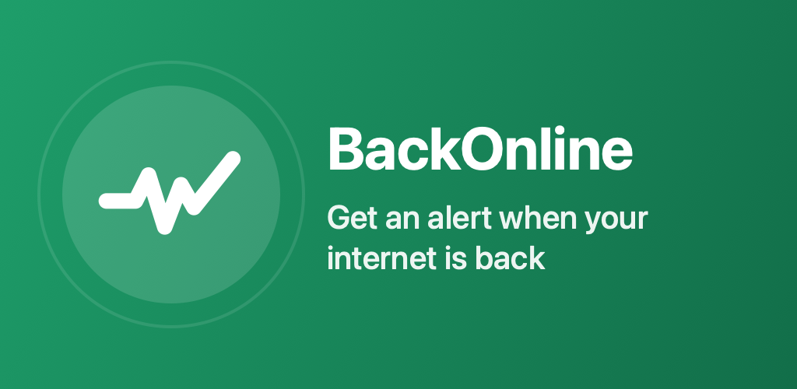
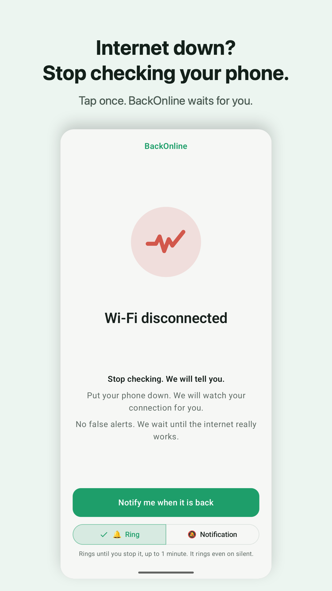
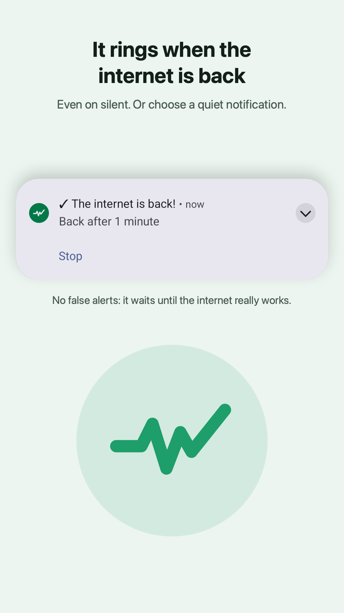
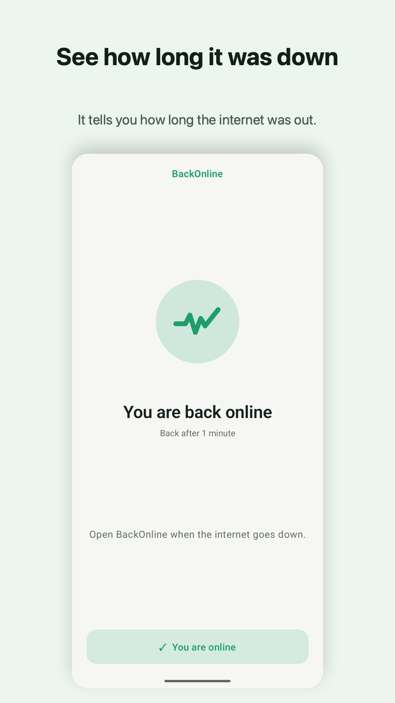
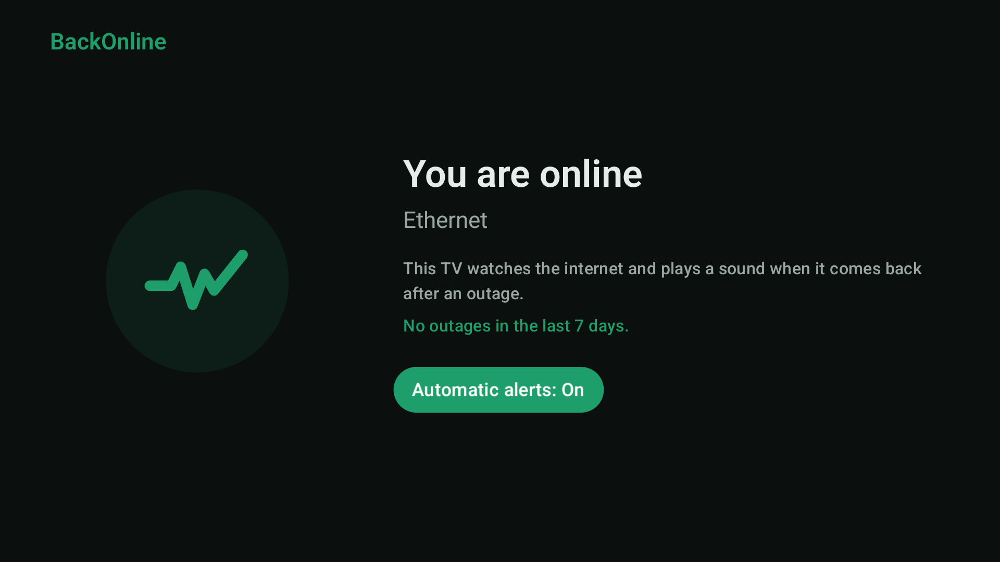

# BackOnline: Wi-Fi Down Alert

Internet down? Get an alarm or a notification the moment your connection is back, so you can stop checking your phone.

<a href="https://play.google.com/store/apps/details?id=com.akshayAshokCode.backonline"></a>



## What it does

- **One-tap alert:** tap "Notify me when it is back", put your phone down, and it rings (or notifies you) when the internet really works again.
- **No false alerts:** it waits until Android validates the internet, not just until Wi-Fi connects.
- **Wi-Fi or mobile data:** it watches Wi-Fi when Wi-Fi is on, and mobile data when Wi-Fi is off.
- **Android TV:** with automatic alerts on, the TV plays a sound when the internet comes back after an outage, and shows the outages of the last 7 days.
- **Private:** no account, no ads, no analytics. Nothing leaves the device. [Privacy policy](https://akshayashokcode.github.io/BackOnline/play/privacy-policy.html)

## Screenshots

<p>
  
  
  
</p>


## Build

```bash
./gradlew assembleDebug    # debug APK (phone and TV)
./gradlew bundleRelease    # release AAB; signs only if keystore.properties exists
```

Kotlin and Jetpack Compose (Compose for TV on Android TV), minSdk 24.
